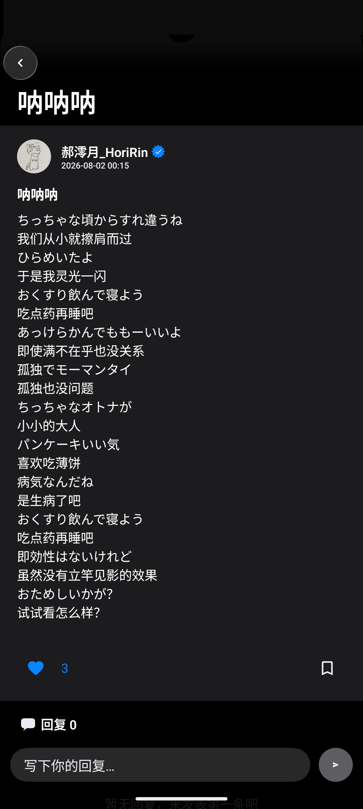

# SoaringBird

<div align="center">

<br><br>
<strong>一个论坛，一个新闻阅读器，一小块可以开直播的场地。</strong><br>
<sub>A forum, a news reader, and a small stage for live conversations.</sub>
</div>

<br>

> [!NOTE]
> 翱翔鸟论坛于 2026 年 6 月 5 日上线，2026 年 12 月 1 日终止服务。
> 这份代码是它留下的全部：一个小型社区用半年时间写成的样子。
> 现在把它完整地开放出来，给任何还想搭一个安静地方的人。

---

## 缘起

2026 年春天，我们想要一个不被推荐算法支配的地方。
不追热点，不做停留时长，不把讨论压缩成十五秒。只是一个版面、一场直播、一篇文章，
和一群愿意多写两句话的人。

三个月后它上线了。半年后我们决定让它停下来——出于实用性与运营上的考量。
停之前，我们把代码整理干净，原样交出来。

## 界面

<div align="center">



</div>

## 能力

| | |
|---|---|
| **论坛** | 发帖、回复、点赞、收藏、标签、分类、草稿恢复、举报与审核 |
| **实时** | 基于 WebSocket 的私信与直播聊天，在线状态即时同步 |
| **直播** | 房间创建、连麦、结束页数据统计 |
| **新闻** | 多源抓取与聚合、频道化呈现、定时调度 |
| **AI 助手** | 帖子内 @ 触发回答，支持任意 OpenAI 兼容接口 |
| **账户** | 邮箱验证、通行密钥（WebAuthn）、第三方登录、登录设备管理 |
| **数据** | 一键导出帖子、回复、评论、收藏，打包为 JSON 与 Markdown |
| **后台** | 内容审核、用户与权限管理、站内公告、邮件群发 |
| **外观** | 浅色 / 深色 / 极客三套主题，全站中英日多语言 |

## 运行

只需要 Python。没有构建步骤，没有前端工具链。

```bash
git clone https://github.com/SoaringBird23/soaringbird.git
cd soaringbird
python3 -m venv .venv && source .venv/bin/activate
pip install -r requirements.txt
cp .env.example .env        # 按需填写
python3 server.py
```

打开 `http://localhost:8080/`。首次启动会自动完成初始化并创建管理员账号，
账号与密码在 `.env` 的 `ADMIN_USERNAME` / `ADMIN_PASSWORD` 中指定；密码留空则随机生成并打印在启动日志里。

## 配置

全部通过环境变量，不写死在代码里。

| 变量 | 作用 |
|---|---|
| `SECRET_KEY` | 会话签名密钥，生产环境务必设置 |
| `ADMIN_USERNAME` / `ADMIN_PASSWORD` | 管理员账号 |
| `RESEND_API_KEY` / `RESEND_FROM` | 发送验证与通知邮件（可选） |
| `TURNSTILE_SITE_KEY` / `TURNSTILE_SECRET_KEY` | 人机验证（可选，留空则关闭） |
| `AI_BASE_URL` / `AI_MODEL` / `AI_API_KEY` | AI 助手接入，兼容 OpenAI 格式（可选） |
| `AZURE_TRANSLATOR_KEY` | 内容翻译（可选） |
| `DATA_DIR` | 运行数据的存放目录，默认当前目录 |

## 结构

```
server.py            后端，单文件：路由、鉴权、实时、导出、调度
index.html           主界面
app29.js             前端逻辑
styles29.css         前端样式
account-ui.css       登录 / 账户页样式
signin.html          登录注册
account.html         账户管理
admin.html/.js/.css  管理后台
live / video / apps / team / peacenews   各频道页面
perspectives.py      视角分析
scheduler.py         资讯调度
source_search.py     外部检索
requirements.txt     依赖
```

## 设计原则

1. **少即是多。** 不加没有必要的按钮，不为了"看起来丰富"堆砌卡片。
2. **文字优先。** 排版、行高、字重比装饰更重要；能用一条线分隔的地方不用阴影。
3. **动效要有理由。** 只动 `transform` 与 `opacity`；尊重 `prefers-reduced-motion`。
4. **数据属于用户。** 导出不是附加功能，而是必须存在的出口。
5. **不追踪。** 没有第三方统计，没有埋点上报。

## 参与

欢迎 issue 与 pull request。动手前请先读 [CONTRIBUTING.md](CONTRIBUTING.md)。
安全问题请勿公开提交，按 [SECURITY.md](SECURITY.md) 私下联系。

## 许可

[MIT](LICENSE) © 2026 SoaringBird

## 中文说明

这是一个用 Flask 与原生 JavaScript 写的完整论坛：后端一个文件，前端没有构建步骤。
把仓库拉下来、装依赖、改 `.env`、跑 `python3 server.py` 就能起来。
代码按原样保留，不做删减；与线上运行的那一份一致。

---

<div align="center"><sub>谢谢你来过。</sub></div>
